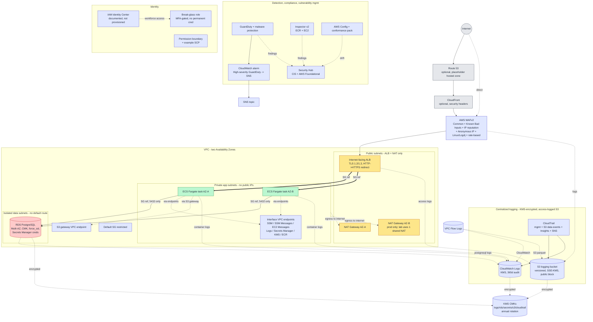

# aws-zero-trust-reference-architecture

[](https://github.com/RIT-MESH/aws-zero-trust-reference-architecture/actions/workflows/validate.yml)
[](https://github.com/RIT-MESH/aws-zero-trust-reference-architecture/actions/workflows/codeql.yml)
[](LICENSE)

A production-oriented **Zero Trust reference architecture on AWS** built with
Terraform: multi-AZ networking, least-privilege IAM, private workloads, customer
managed encryption keys, continuous security monitoring, and DevSecOps
validation.

> **Disclaimer:**  Review and
> adapt it to your organization before any real use.

## Project overview

The architecture implements the NIST SP 800-207 Zero Trust tenets on AWS:

1. Verify explicitly
2. Least-privilege access
3. Assume breach
4. No direct administrative access to workloads
5. Network segmentation
6. Encryption in transit and at rest
7. Continuous logging, detection, compliance, and vulnerability management
8. Infrastructure as Code, automated validation, and secure CI

Ingress flows: **Route 53 -> optional CloudFront -> AWS WAF -> internet-facing
ALB -> private ECS Fargate -> isolated RDS PostgreSQL**, with CloudTrail, VPC
Flow Logs, Config, GuardDuty, Security Hub, and Inspector providing continuous
telemetry to a KMS-encrypted, access-logged S3 bucket.

## Why this improves on a basic design

A "basic" AWS setup commonly exposes workloads with public IPs, uses broad
CIDR security groups, relies on a single shared KMS key, has no flow logs or
CloudTrail, grants `AdministratorAccess` to workload roles, and uses long-lived
IAM users/access keys. This reference instead:

- Puts every workload in private/isolated subnets with **no public IPs**.
- Uses **security-group references** (ALB->app->DB) instead of broad CIDRs.
- Uses **separate customer-managed KMS keys** per concern with rotation enabled.
- Wires **CloudTrail, Flow Logs, Config, GuardDuty, Security Hub, Inspector**.
- Gives workloads a **deny-by-default** task role plus a **permission boundary**.
- Provides an **MFA-gated break-glass role** with no permanent credential.
- Enforces the invariants with **automated tests and IaC scanning**.

## Zero Trust principles -> AWS controls

See [`docs/zero-trust-principles.md`](docs/zero-trust-principles.md) for the full
mapping. Summary: explicit verification (IAM roles + MFA break-glass + TLS),
least privilege (deny-by-default roles + permission boundary + SG references),
assume breach (isolated data tier + GuardDuty + CloudTrail Insights), no direct
admin (no SSH/RDP + Session Manager + SSM endpoints), segmentation (tiered
subnets + route tables + default SG locked), encryption (CMKs everywhere +
`rds.force_ssl` + S3 deny-insecure), and continuous monitoring (Config/GuardDuty/
Security Hub/Inspector + CloudWatch alarms).

## Architecture diagram

This is the topology of the two-AZ Zero Trust architecture. GitHub renders the
Mermaid block below natively; a plain-text version follows for non-rendered viewers.



<details><summary>Plain-text topology</summary>

```text
Internet -> Route 53 (optional) -> CloudFront (optional) -> AWS WAF -> ALB (public subnets)
ALB --SG ref--> ECS Fargate (private app subnets, no public IP)
ECS --SG ref, 5432 only--> RDS PostgreSQL (isolated data subnets, no default route)
ECS --interface endpoints--> SSM/Logs/Secrets/KMS/ECR ; ECS --S3 gateway--> S3
ECS --NAT--> internet (no public IP on tasks)
Telemetry: CloudTrail, VPC Flow Logs, ALB/WAF logs, RDS/ECS logs -> S3 (KMS) + CloudWatch (KMS, 365d)
Detection: GuardDuty -> CloudWatch alarm -> SNS ; Security Hub aggregates CIS + Foundational + Inspector + Config
Identity: IAM Identity Center (docs) ; MFA break-glass role ; permission boundary + example SCP
Encryption: KMS CMKs (logs/rds/secrets/s3/cloudtrail) with annual rotation ; rds.force_ssl=1 ; S3 deny-insecure
```

</details>

See [`docs/architecture.md`](docs/architecture.md) for the full diagram (ASCII +
Mermaid) and the tier/route-table breakdown.

## Main security controls

- No public IPs on app/data workloads; no SSH/RDP ingress anywhere.
- Tiered VPC: public (ALB+NAT), private app (ECS), isolated data (RDS, no default route).
- ALB TLS 1.2/1.3 with HTTP->HTTPS redirect; WAF (Common, Known Bad Inputs, IP
  reputation, Anonymous IP, Linux/Log4j) + per-IP rate-based rule.
- Customer-managed KMS keys (logs, rds, secrets, s3, cloudtrail) with rotation.
- RDS: not public, CMK-encrypted, `rds.force_ssl=1`, Secrets Manager credentials,
  Multi-AZ + deletion protection (production), enhanced monitoring, query logging.
- CloudTrail (mgmt + S3 data events + Insights + SNS), VPC Flow Logs (CW + S3
  parquet), ALB/WAF logs, all to a versioned, access-logged, SSE-KMS S3 bucket.
- GuardDuty (with malware protection), Security Hub (CIS + AWS Foundational),
  Inspector v2, AWS Config with a conformance pack, and a high-severity alarm.
- IAM: least-privilege workload role, permission boundary, MFA break-glass role,
  example SCP (output as JSON for org application).

## Repository structure

```text
modules/
  network/            # VPC, subnets, route tables, flow logs, endpoints, default SG
  kms/                # customer-managed KMS keys with rotation
  s3-logging/         # centralized, encrypted, access-logged S3 bucket
  cloudtrail/         # CloudTrail + SNS + CloudWatch Logs + Insights
  edge/               # ALB, WAF, target group, app SG, listeners
  ecs-app/            # ECS Fargate service, roles, autoscaling
  rds/                # RDS PostgreSQL, parameter group, monitoring
  security-services/  # Config, GuardDuty, Security Hub, Inspector, alarms
  iam/                # break-glass role, permission boundary, example SCP
examples/
  production/         # Multi-AZ, NAT per AZ, full security, 365d audit logs
  lab/                # cost-sensitive: single NAT, single-AZ RDS, 1 task
modules/rds/tests/        # native Terraform tests (mock provider)
modules/network/tests/    # native Terraform tests (mock provider)
tests/python/             # static security-invariant tests (pytest)
scripts/validate.sh       # validation orchestration (CI)
backend.hcl.example       # placeholder S3 remote-backend config
.github/workflows/        # validate + codeql + terraform-deploy.example
.github/dependabot.yml    # Dependabot config
docs/                     # architecture, threat model, controls, ops, IR, cost,
                          # deployment, aws-authentication, github-oidc, testing
SECURITY.md
```

## Prerequisites

- Terraform >= 1.6 (validated on 1.15.x).
- AWS provider ~> 5.0 (resolved to 5.100.0).
- For local validation: `terraform`, `python 3`, `pytest`, `checkov`, optional
  `PyYAML`. No AWS credentials are required for any validation step.
- For real deployment: an AWS account, an ACM certificate, a container image
  serving `GET /health` -> 200, and placeholders replaced with your values.

## AWS authentication

This project uses the standard AWS credential provider chain. No credentials are
stored in the repository.

Recommended for local use:

```bash
aws configure sso
aws sso login --profile zero-trust-prod
export AWS_PROFILE=zero-trust-prod
export AWS_REGION=ap-northeast-1
```

Alternative methods include an AWS CLI profile, environment-based credentials, an
attached IAM role, or GitHub Actions OIDC.

Verify authentication before planning:

```bash
aws sts get-caller-identity
```

Then initialize and review the deployment:

```bash
cd examples/production
terraform init
terraform fmt -check
terraform validate
terraform plan -out=tfplan
terraform show tfplan
```

Apply only after reviewing the plan:

```bash
terraform apply tfplan
```

> Do not store AWS access keys in Terraform files, tfvars files, shell scripts,
> GitHub repository variables, or committed configuration.

See [docs/aws-authentication.md](docs/aws-authentication.md) and
[docs/github-oidc.md](docs/github-oidc.md) for details.

## Local validation and testing

Automated checks run without contacting AWS: `terraform fmt`, `terraform validate`,
native Terraform tests (mock provider), static Python tests, Checkov, TFLint, and
secret scanning. See [docs/testing.md](docs/testing.md) for the full workflow.

```bash
terraform fmt -check -recursive
( cd examples/production && terraform init -backend=false && terraform validate )
( cd examples/lab       && terraform init -backend=false && terraform validate )
( cd modules/rds    && terraform init -backend=false && terraform test )
( cd modules/network && terraform init -backend=false && terraform test )
python -m pytest tests/python -q
checkov -d examples/production --framework terraform --quiet
checkov -d examples/lab       --framework terraform --quiet
bash scripts/validate.sh
```

Results are recorded in [docs/validation-report.md](docs/validation-report.md).

## Lab and production usage examples

Both examples are self-contained Terraform roots with placeholder defaults in
`terraform.tfvars.example`. Copy to `terraform.tfvars`, replace the placeholders
(account ID, domain, ACM certificate ARN, allowed CIDRs, container image), then:

```bash
cd examples/production   # or examples/lab
cp terraform.tfvars.example terraform.tfvars
# edit terraform.tfvars and configure a remote backend
terraform init
terraform plan    # review
terraform apply   # only after human review
```

Remember: this repo never applies anything for you.

## Variables and outputs

Each module documents its inputs in `variables.tf` and its outputs in
`outputs.tf`. Example-level variables (region, VPC CIDR, AZs, certificate ARN,
allowed CIDRs, container image, DB class, tags) are in
`examples/*/variables.tf`. Key outputs include the ALB DNS name, VPC ID, ECS
cluster, RDS endpoint, DB master secret ARN (value never exposed), CloudTrail
name, and break-glass role ARN.

## Cost warning

Running this is **not free**. Production is roughly ~$300-450+/mo (dominated by
Multi-AZ RDS and NAT Gateways); the lab ~$120-180/mo. See
[`docs/cost.md`](docs/cost.md) for levers and cleanup.

## Security limitations

- IAM Identity Center is documented, not provisioned (requires an AWS org).
- CloudFront and Route 53 are optional/documented to keep `terraform validate`
  free of a real hosted zone.
- Secrets Manager rotation Lambda for RDS is out of scope; configure in prod.
- SCPs are provided as an example JSON output; apply them at your org/OU level.
- This is a single-account reference; multi-account/org design is out of scope.

## Known trade-offs

- Lab example deliberately disables RDS Multi-AZ and deletion protection for
  cost and easy teardown (both enabled in production; checkov-suppressed with
  justification).
- Log retention is 365 days for audit logs; container logs use the same default
  but are tunable down for cost.
- Network ACLs remain at AWS defaults (documented); security groups are the
  primary segmentation control.
- A few checkov checks are suppressed inline with written justifications (see
  `docs/security-controls.md`).

## Cleanup

```bash
cd examples/production   # or the example you applied
terraform destroy
# Then manually remove the S3 logging bucket and KMS keys (KMS has a waiting period).
```

This project is **not** applied automatically.

## CI

- `.github/workflows/validate.yml` - fmt, init+validate both examples, native
  tests, pytest, checkov (both examples), YAML/JSON check, and `validate.sh`.
  Minimal permissions; no AWS credentials; no real `terraform plan`.
- `.github/workflows/codeql.yml` - CodeQL analysis for the Python test code.
- `.github/workflows/terraform-deploy.example.yml` - optional OIDC deployment
  workflow (plan on PRs, apply via a protected environment with manual approval).
  Named `*.example.yml` so it does not run automatically; see
  [docs/github-oidc.md](docs/github-oidc.md) to enable it.
- `.github/dependabot.yml` - github-actions, terraform, and pip ecosystems.

## License

MIT - see [LICENSE](LICENSE).
