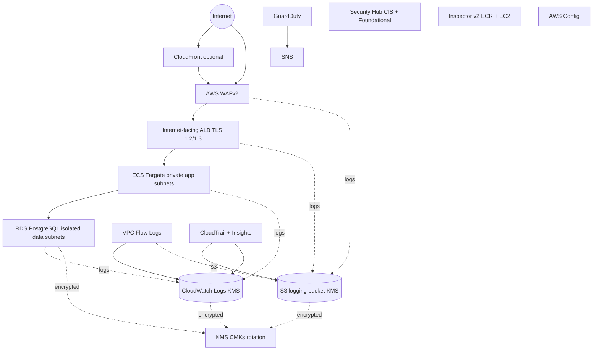

# Architecture

## Overview

A highly available, two-AZ AWS VPC implementing a Zero Trust reference
architecture. Public ingress is funneled through AWS WAF and an internet-facing
Application Load Balancer; application workloads run in private subnets with no
public IPs; data lives in isolated subnets; and the whole platform emits
continuous telemetry to encrypted, access-logged storage.

```
                       Internet
                          |
                    +-----------+
                    | Route 53  |  (optional, placeholder hosted zone)
                    +-----------+
                          |
                 +------------------+      (optional, documented)
                 |   CloudFront     |      security headers / edge caching
                 +------------------+
                          |
                    +-----------+
                    | AWS WAFv2 |  managed rule groups + rate-based rule + Log4j rules
                    +-----------+
                          |
            +---------------------------+
            | Internet-facing ALB (2 AZ) |  TLS 1.2/1.3, HTTP->HTTPS redirect
            +---------------------------+
                |                       |
   +------------+------------+   ALB access logs -----> S3 (KMS, access-logged)
   |  public subnets (ALB+NAT)|
   +--------------------------+
                |
   +--------------------------+
   |  private app subnets     |   ECS Fargate (no public IP), SG references ALB SG
   |  ECS service (2+ tasks)  |   Session Manager endpoints (SSM/EC2/SSMMessages)
   +--------------------------+
                |
   +--------------------------+
   |  isolated data subnets   |   RDS PostgreSQL (Multi-AZ, CMK, Secrets Manager)
   |  no default route        |   DB SG accepts only the app SG
   +--------------------------+

   Cross-cutting:
     - KMS CMKs (logs, rds, secrets, s3, cloudtrail) with rotation
     - CloudTrail (mgmt + S3 data events, Insights) -> S3 + CloudWatch
     - VPC Flow Logs -> CloudWatch + S3 (parquet)
     - AWS Config, GuardDuty, Security Hub (CIS + AWS Foundational), Inspector
     - S3 gateway endpoint + interface endpoints (SSM, Logs, Secrets, KMS, ECR)
     - IAM: workload roles (least privilege), permission boundary, MFA break-glass
```

## Mermaid diagram



## Tiers and route tables

| Tier | Subnets | Route table | Internet route | Public IPs |
|---|---|---|---|---|
| Public | ALB + NAT GW | public RT -> IGW | yes (via IGW) | only ALB/NAT EIPs |
| Private app | ECS Fargate | per-AZ app RT -> NAT GW | yes (via NAT) | **none** |
| Isolated data | RDS | data RT (no default route) | **none** | **none** |

## Components -> modules

| Concern | Module |
|---|---|
| VPC, subnets, route tables, flow logs, endpoints, default SG | `modules/network` |
| Customer-managed KMS keys | `modules/kms` |
| Centralized logging bucket | `modules/s3-logging` |
| CloudTrail + SNS + CloudWatch | `modules/cloudtrail` |
| ALB, WAF, target group, app SG | `modules/edge` |
| ECS Fargate service, roles, autoscaling | `modules/ecs-app` |
| RDS PostgreSQL, parameter group, monitoring | `modules/rds` |
| Config, GuardDuty, Security Hub, Inspector, alarms | `modules/security-services` |
| Break-glass role, permission boundary, example SCP | `modules/iam` |

## Examples

- `examples/production` - Multi-AZ, NAT GW per AZ, WAF with IP reputation,
  Multi-AZ RDS, deletion protection, 365-day audit log retention.
- `examples/lab` - Single NAT GW, single-AZ RDS, 1 task, deletion protection off
  for easy teardown, lower log retention. Same security invariants enforced.

Both examples `terraform init` and `terraform validate` cleanly **without AWS
credentials** (no data source requires STS, and native tests use a mock provider).
